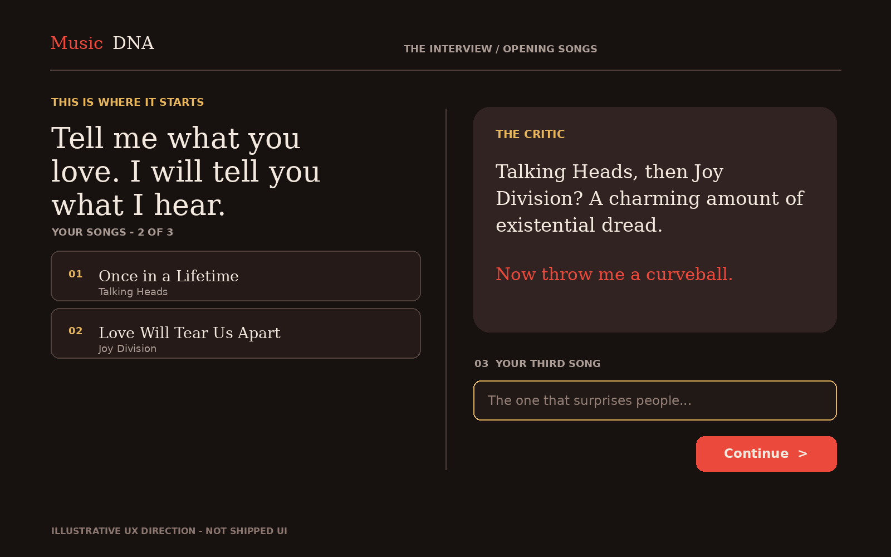
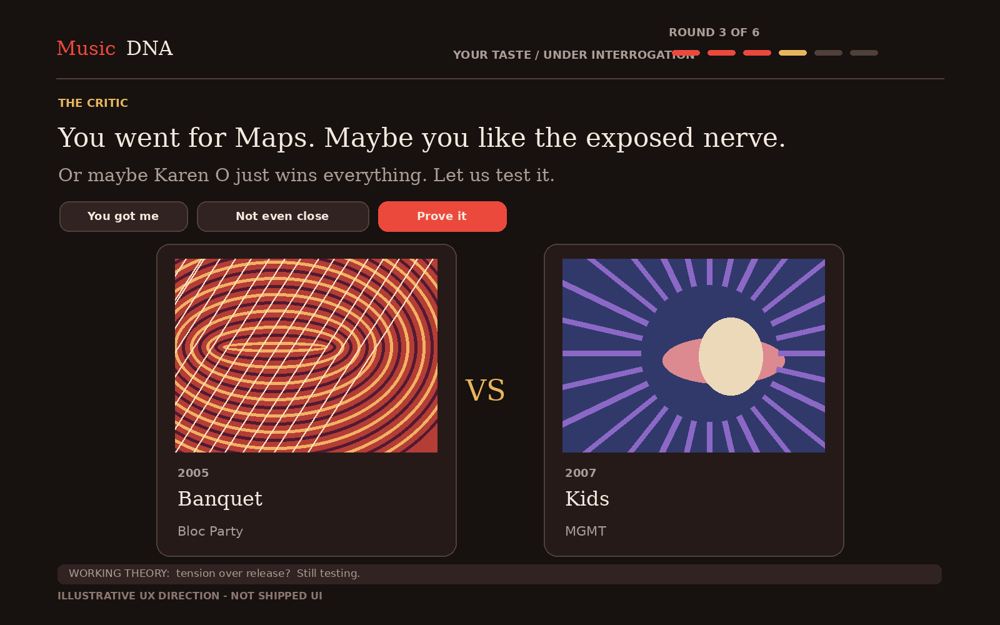
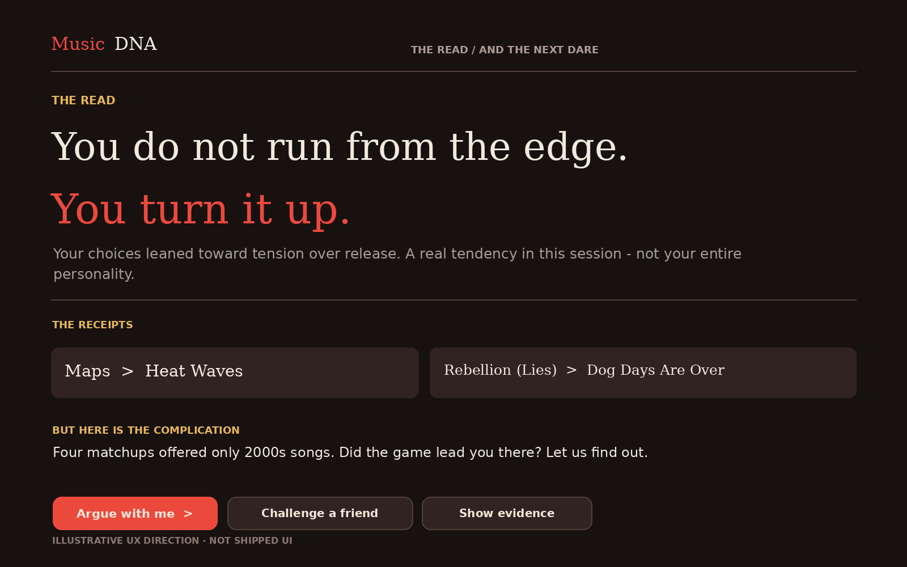

# MusicDNA | The Critic Experience Reset

**UX review, interaction direction, and Lovable implementation brief**  
**Date:** November 8, 2026  
**Source:** Live production walkthrough at `https://www.musicdna.fm/`, cross-checked against `main` (`7a3a977`)  
**Status:** Proposed direction, not an approved implementation or change to diagnostic policy

> **Great engine. Wrong stage.** MusicDNA feels like a psychological assessment when it should feel like sparring with a ridiculously perceptive, slightly irreverent music critic.

## Executive verdict

MusicDNA's concept remains strong: *music is the interface, identity is the product, and the listener's choices are the evidence*. The promise is a three-minute exchange that makes a listener think, **"How did it know that about me?"**

The current web flow has an evidence-conscious backend, meaningful choice data, and real mechanisms for revisions and feedback. Yet its presentation is text-heavy, repetitive, clinical, and weak at encouraging the next action. It puts the diagnostic bookkeeping onstage while hiding the critic's personality and the dramatic arc.

**Recommendation:** Freeze the validated evidence/completion/security contracts for this pass. Prototype and approve three screen states before production implementation: (1) opening conversation, (2) active matchup with critic banter, and (3) reveal with playable challenge. Treat this as a front-end presentation and bounded-expression redesign, not a backend rewrite or another feature expansion.

## What was tested

One anonymous production session with these opening songs:

1. `Once in a Lifetime — Talking Heads`
2. `Love Will Tear Us Apart — Joy Division`
3. `Redbone — Childish Gambino`

The six answered pairings were:

| Round | Chosen | Rejected | Current experience |
|---|---|---|---|
| 1 | Rebellion (Lies), Arcade Fire | Dog Days Are Over, Florence + the Machine | "Choice noted" and "Still listening" |
| 2 | Maps, Yeah Yeah Yeahs | Heat Waves, Glass Animals | Tentative "danger over release" theory |
| 3 | Banquet, Bloc Party | Kids, MGMT | Repeated the previous theory |
| 4 | Breezeblocks, alt-J | De Selby (Part 2), Hozier | Count-based "3 supporting choices" read |
| 5 | Mr. Brightside, The Killers | Use Somebody, Kings of Leon | Same read with an incremented count |
| 6 | Kids, MGMT | Maps, Yeah Yeah Yeahs | Same read, then a largely repeated finale |

Also tested `Not quite` and sent a post-reveal correction: *"I chose Maps because of Karen O's vulnerable vocal, not because I want danger. You're reducing all six picks to one vague axis. What else do you notice?"* The critic replied: *"I couldn't ground that reply in your choices. Which part of the music mattered most to you?"* The updated interpretation appended the user's correction to the original reading rather than producing a satisfying conversational response. This is a directly observed failure of the payoff, not proof that the underlying feedback was not saved.

The live session was private and unpublished. No application code was changed by this review.

## Findings and priority

### P0 — The critic does not reward participation

The first two opener replies were "Interesting place to start" and "Two very different rooms. Interesting." Three user-entered favorite songs demand some effort, but the first reward is generic and late. A critic should react to *the actual music* and create curiosity without claiming a listener trait from one or two examples.

**Target:** One specific, brief, human response after each opener. Move directly to the next prompt. A little provocation is welcome; confidence must remain earned.

### P0 — The page has no center of gravity

Submitted songs, reactions, opening observation, collapsed history, current thesis, matchup, and eventually the result pile into a growing vertical transcript. The active task competes with prior commentary. Two songs appear as austere text rectangles, with almost no music-related visual reward.

**Target:** One active stage. Keep the current matchup, one-breath critic response, explicit progress, and next action within a coherent viewport. Prior choices are available in a discreet history drawer, not a sprawling primary canvas. Use cover art when licensed/available; otherwise use deliberate original cover-style art and kinetic musical typography. Do not make playback mandatory for a three-minute session.

### P0 — Evidence safeguards have become the critic's voice

Every choice receives the same deterministic acknowledgement: "Choice noted. A pattern needs independent evidence." The running/final read outputs counts and caveats as the main copy, e.g. "4 supporting choices, 0 against" and "A tendency in these choices, not an identity." The AI selects among authorized claims, but displayed language is assembled from strict templates. This produces accuracy without personality.

**Target:** Preserve the ledger, eligibility, exceptions, and citations as authoritative structured data. Render a separate *bounded expression layer* with short editorial lines, an explicit uncertainty tier, and a specific supporting example. Do not let an LLM invent diagnostic facts. Put counts and confounds in expandable evidence, not the hero line.

### P1 — Disagreement appears to vanish

`Not quite` triggers a server reaction and next-pairing steer, but the visible acknowledgement primarily arrives via a transient toast. The replacement/steered matchup does not visually explain why the listener's input mattered. The post-result conversation starts on a new page below the full prior report; the observed reply was a generic grounding fallback.

**Target:** Show disagreement inline as a real turn of dialogue: "Fair. I may be confusing nostalgia with tension. Let's test that." Immediately make the next pairing feel consequential. If AI output fails validation, use a specific humane fallback that acknowledges the user's actual correction and offers two directed follow-ups, without overclaiming a changed diagnostic vector.

### P1 — The finale repeats instead of revealing

The six-choice payoff largely echoes the previous working theory, then foregrounds a methodological caveat. There is no visually distinct reveal, memorable statement, or compelling continuation loop.

**Target:** Lead with one concise, arresting, evidence-permitted sentence. Below it: two actual choice receipts; one unresolved counter-hypothesis; then three actions: **Argue with me**, **Challenge a friend**, **Show the evidence**. Sharing should remain explicit opt-in.

### P1 — The pairing catalog can manufacture an apparent era preference

In the observed session, four of six pairings offered **only songs from the 2000s**. Five of six chosen songs therefore fell in that era, and the finale noted this as a possible confound. A significant fraction of that concentration was imposed by the pairing set, not expressed freely by the listener. This is both a research-quality issue and a trust problem when exposed in copy.

**Target:** Audit offer-side versus choice-side era concentration. Treat a dimension with little variation among the offered options as weak evidence of listener preference. Where possible, diversify eras and subcultures while keeping each pairing diagnostically valid. Never imply that a forced choice independently established an era preference.

## Proposed UX screens

The images below are **interaction-direction mockups, not shipped UI**. Cover-style illustrations are original placeholders, not official album art. They demonstrate hierarchy, flow, tone, and visual energy; the example language is illustrative and still subject to evidence validation.

### Screen 1 — Opening conversation

- Preserve three opening songs, one at a time, with a visible count.
- Critic responds specifically to the selection instead of saying "Interesting."
- Next prompt and input remain on the same active stage.
- No upfront trait diagnosis. Three favorite songs are self-report priors, not independent pairing votes.

### Screen 2 — The active matchup

- **The songs are heroes**: two high-contrast visual cards, easy selection, immediate winner/loser feedback.
- The critic's latest line is short and visible; hidden methodology lives behind "Why?" or "Show evidence".
- `That's me`, `Not quite`, and `Prove it` are real, visible actions with inline consequences.
- Keep `Round X / 6` and a small growing theory chip; no long wall of transcript.
- Maintain skip for unknown songs and the server's actual stop policy.

### Screen 3 — Big reveal, then challenge

- Deliver one striking, warranted sentence first.
- Show two receipts drawn from the authorized ledger.
- Reveal a real unresolved tension or counterexample, without manufacturing drama.
- The primary continuation is **Argue with me**, in the same visual world, not a long duplicate report on a new page.
- Sharing remains voluntary, clear, and revocable under the existing publication contract.

## Voice and pacing contract

**Desired critic:** curious, witty, perceptive, occasionally provocative, willing to revise, never elitist or falsely certain. A music-loving person with a point of view, not a personality-test narrator.

**Avoid:** repeated "noted", "still listening", raw evidence counts in hero copy, generic psych language, ontology/axis names, unexplained placeholders, empty questions with no way to respond, and conclusions that only rephrase the previous round.

**Example progression** (illustrative copy, subject to evidence checks):

- **Opening:** "Talking Heads, then Joy Division? A charming amount of existential dread. Throw me a curveball."
- **After a first pick:** "Maps over Heat Waves. Okay, that is an interesting nerve to touch. I'm not calling it yet."
- **Working theory:** "You might prefer the exposed nerve to the easy exit. Or maybe Karen O wins everything. Want to test that?"
- **After pushback:** "Fair. The voice might be the whole story. Let's see whether that holds when the singer changes."
- **Reveal:** "You don't run from the edge. You turn it up." Subline: "Across these choices, tension beat release - but the 2000s-heavy pairings may be part of why."

**Pacing:**

1. Opener 1-3: each answer wins a tiny reaction; no diagnosis.
2. Rounds 1-2: specific observations, intrigue, low confidence.
3. Rounds 3-4: a falsifiable theory or candid mixed evidence; make the next test intentional.
4. Rounds 5-6: counterexample/revision if earned; no scripted reversal if evidence does not support it.
5. Reveal: a fresh editorial synthesis, not another count increment.
6. Continuation: user correction changes the dialogue immediately; diagnostic evidence stays frozen unless new actual choices are made.

## Implementation approach for Lovable/Codex

**Phase A — Design approval first.** Prototype three screen states and a full six-round storyboard with sample copy, desktop and small-phone sizes. Get ACE approval for the interaction before integrating APIs.

**Phase B — Presentation shell.** Replace the transcript-first layout in `src/routes/onboarding.tsx`; refactor `src/components/musicdna/song-choices.tsx`, `interview-history.tsx`, and `read-moment.tsx`. Keep the current choice/skip/resume mutations, progress and server completion intact.

**Phase C — Bounded critic expression.** Retain `buildLedger`, `evaluateClaim`, `projectRead`, the evidence thresholds, and real revision detection. Add an authorized display model such as `{stage, short_line, evidence_ids, confidence_tier, counter_hypothesis, next_action}` where the sentence is validated against structured evidence. Separate entertaining expression from invariant claim facts. The current rigid strings in `src/musicdna/engine/claim-language.ts` remain valid audit language, not required hero copy.

**Phase D — Interactive pushback and payoff.** In `src/hooks/use-interview.ts`, expose the server reaction message/effect inline rather than only via toast. Rework `src/routes/me.tsx` and `reading-conversation.tsx` so the challenge opens directly with the critic and the prior result is compact. Treat `fallbackChat` failures as a first-class UX state. Render the final headline, receipts, tension, and next action as distinct fields rather than one long synthesis heading.

**Phase E — Pairing quality.** Audit sample sessions for offer-side era/artist/subculture concentration, counterexamples, known-song coverage, and a clear diagnostic tradeoff. Do not alter the canonical policy casually; route catalog changes through existing validation.

### Guardrails: do not break

- All listener claims come from the canonical frozen choice evidence and existing claim policy (`AGENTS.md`).
- Never promote opener songs or chat self-report into independent pairing votes.
- The server owns completion and skip rules; web and Flutter agree.
- Never promise a question the selected next pairing does not test.
- Preserve atomic/idempotent choices, full history resume, explicit share publication/revocation, and chat versioning.
- Mobile API v1/legacy behavior and rollout flags remain compatible. This proposal does not authorize a Flutter parity rewrite or Echelon/Agent Brain expansion.

## Acceptance criteria

1. On a 390px mobile viewport, the current critic line, active choice, and progress are discoverable without hunting through prior history.
2. No more than one short critic statement and one question are emphasized per interaction; supporting methodology is secondary.
3. First two opener reactions reference the music specifically without claiming a supported listener trait.
4. Six rounds feel narratively different: observation, theory, test, possible revision, conclusion. Repetition is prevented even when the top evidence axis stays unchanged.
5. `Not quite` and `Harder` produce a visible in-context response and demonstrably relevant next pairing or an honest "no alternative" explanation.
6. The last reveal is visually distinct and adds synthesis beyond the previous running theory.
7. An explicit pushback mentioning a song's vocal is acknowledged as the user's interpretation, not falsely rejected as ungrounded or treated as an additional vote.
8. All copy uses actual selected/rejected song names and eligible evidence; no invented facts, overconfidence, or ontology leakage.
9. Pairing diversity metrics distinguish offered catalog concentration from the listener's selected concentration.
10. The entire first session can plausibly complete in about three minutes with reduced-motion and keyboard-accessible alternatives; no new mandatory steps.

## Code pointers and root causes

| Area | Current source | Review finding |
|---|---|---|
| Opener layout | `src/routes/onboarding.tsx` | Large sequential transcript; a long opening observation can push the game away |
| Matchup visuals | `src/components/musicdna/song-choices.tsx` | Plain typographic tiles with little musical identity |
| Reaction layout | `src/components/musicdna/interview-history.tsx` and `read-moment.tsx` | Choice recap + thesis + question repeat; reaction actions compete with next pairing |
| Generic acknowledgement | `src/lib/musicdna.functions.ts` | Fixed `"Choice noted. A pattern needs independent evidence."` on every vote |
| Clinical claims | `src/musicdna/engine/claim-language.ts` | Bounded text places counts/caveats in the primary sentence |
| Running read | `src/musicdna/engine/read.ts` | `boundedClaim` repeated as the hero thesis; generic question if evidence thin |
| Reaction visibility | `src/hooks/use-interview.ts` | Backend reaction `message` delivered primarily in a transient toast |
| Finale | `src/components/musicdna/reading-result.tsx` | Entire synthesis appears inside a large headline |
| Pushback | `src/routes/me.tsx` | Full original report rendered before the conversation |
| Chat fallback | `src/musicdna/engine/claim-language.ts` | Generic "couldn't ground" fallback fails to acknowledge an actual correction |

**North star:** The listener should feel noticed, challenged, occasionally surprised, and invited to keep arguing. **Not a playlist generator. A mirror for your taste.**
