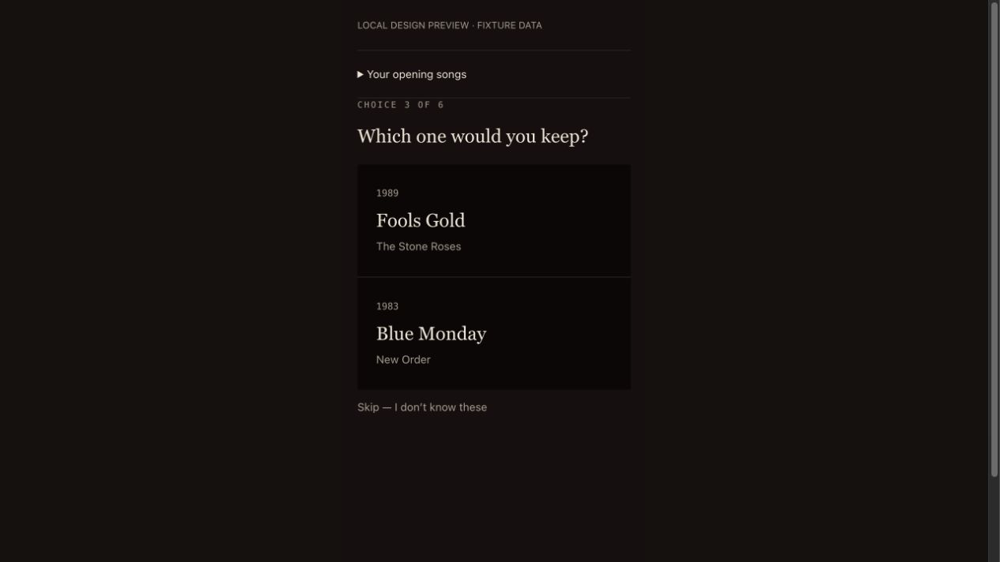
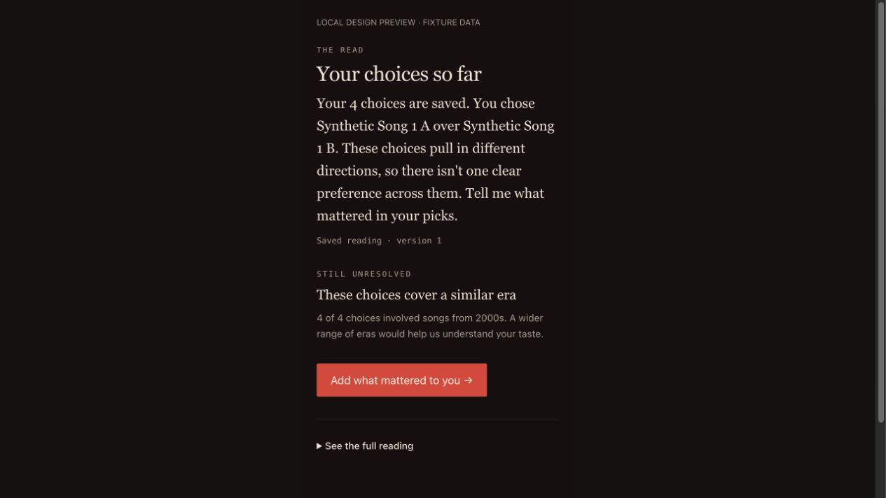

# AB-56: clearer responses and a shorter web flow

This Music DNA PR implements the shared response/selection fixes and web presentation changes from the November 8 UX review. Native screen acceptance remains pending; the attached images are explicitly labeled local fixtures at a 390px responsive viewport, not TestFlight screenshots or evidence of better readings.

## Resulting behavior

- The first two opening-song acknowledgements use catalog facts only, with no model call. Input hints ask for title and artist. Ambiguous titles and incorrect artist hints no longer resolve to the first catalog row. Hyphens inside titles are preserved. The third-song conversational observation remains, with an instruction not to ask a written question before a song-choice screen.
- A saved pick is acknowledged by its actual song comparison. The repeated “A pattern needs independent evidence” line is removed from new responses. Existing saved/replayed feedback and result versions are not rewritten.
- New uncertain readings name an actual ledger-backed choice, explain the uncertainty and invite context. They do not manufacture a supported claim or lower the evidence thresholds. Web presents this text beneath a short heading instead of turning the entire paragraph into a large headline.
- Shared reading caveats describe repeated songs, artists, styles and eras in ordinary language. Operator lane keys, frozen-evidence terminology and “confound” are not emitted in new user-facing caveats. Both REST/mobile and web receive the same new content; the wire shapes stay unchanged.
- The selector prefers two songs not yet answered in the session, **within** its eligible lane/recognition/artist/fork pool. It falls back to that eligible pool when necessary, so freshness does not falsely exhaust the catalog or loosen safeguards. Real, fallback and shadow picks use the same seen-song input. Marked bootstrap selection uses the same preference within its existing constraints.
- Web collapses the opening transcript after the first answer, retaining an expandable reference. Waiting text appears only while the first matchup is loading. The progress label counts answered choices rather than skips. Song controls are action buttons with explicit accessible names and visible selected state. The uncertain-result action invites the listener to add context.

## Catalog follow-up

The read-only review found 488 active songs but only 203 represented in active pairings; 285 active songs had no active matchup. Alternative had 40 matchups using 56 songs. These are dated operator observations, not fixed product inventory claims.

`tools/musicdna/sql/catalog-coverage.sql` provides aggregate per-lane coverage and declared-test diagnostics inside an explicit READ ONLY transaction with a 10-second local timeout. Use it to prioritize reviewed pairings for suitable existing songs before bulk imports. This PR does not activate new pairings or add unreviewed catalog data. Freshness improves use of the existing eligible pool; it does not increase inventory or prove quality improvement.

## Release boundary

No migration, credential, environment flag, deployment, hostname, public V1 gate or learning/export switch changes are included. The installed TestFlight beta remains on its restored legacy backend until a separately verified compatible beta is ready. Mobile-only duplicate error presentation and physical-phone keyboard/scroll review remain on AB-56.

Selector source changes require a new `routing-artifact.json` pin. Existing AB-52 invitations retain their frozen old pin and must not silently follow this code: they fall back to ordinary routing when the deployed artifact does not match. Do not mutate old assignments or relabel completed readings. A later pilot needs its own approved version/consent handling after the beta compatibility check.

## Verification

Application tests, pure selector/claim-language cases, actual database role/replay/privacy suites, TypeScript, changed-file lint and a Vercel-target build are checked before review. The UI preview renders the real changed components with labeled fixture data, no production or provider requests; opening-context expansion was exercised. This is development verification, not completed native acceptance.

### Local responsive previews

